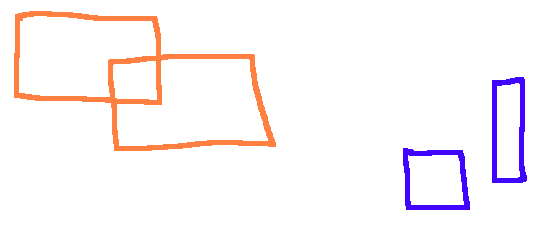

I oppgavene nedenfor er du nødt til ta noen avgjørelser og gjøre noen
antakelser. Beskriv disse.

**a)** Implementer en datatype `struct rect` som holder et rektangel (altså en
    firesidet figur med kun rette vinkler).

**b)** Anta at vi har gjort `typedef struct rect rect_t;` slik at vi slipper å
    skrive `struct rect` hele tiden. Skriv en funksjon som tar inn  to `rect_t` og
    sjekker om de overlapper.

**c)** Skriv en funksjon som tar inn et array av `rect_t` og sjekker at ingen
    av dem overlapper.

